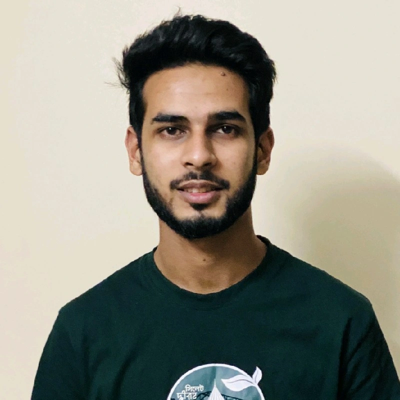

# Mazhar

## Study background

I am a first-semester M.Sc. Computer Science student at Paderborn University, with a B.Sc. in Computer Science and Engineering from Leading University in Bangladesh. I also have three and a half years of work experience.

[Portfolio](https://cloud-007.github.io/)

## Interests

- Building my own products and automating repetitive tasks to make everyday life easier.
- Learning more about system architecture, engineering fundamentals, networking and security to build reliable solutions.
- Connecting with more people, exchanging ideas and learning from their experiences.

## Fun fact

After three and a half years in software, I’m back at university learning to delegate to AI and hoping it still leaves me a job.

## What I think about AI in software engineering today

AI is making routine coding cheaper and reducing the amount of repetitive implementation work. I think this puts more emphasis on architecture, security, reliability and solving complex engineering problems. The same tools that help us build software can also make weaknesses easier to exploit when security is overlooked. I want to understand the fundamentals well enough to build useful systems and check that they are dependable.

## Where software engineering will be in 5–10 years

I honestly do not know what software engineering will look like in 5–10 years, and the pace of progress feels scary. I worry that AI could advance faster than we learn to use it safely and fit it into everyday life. As more people can build software and more work becomes automated, I wonder what that will mean for jobs and people's roles. I hope we put as much effort into guidance, security and responsible use as we put into making AI more capable.

## My hot take on AI

AI puts building within more people's reach; curiosity, creativity and learning how to guide it make the difference.
